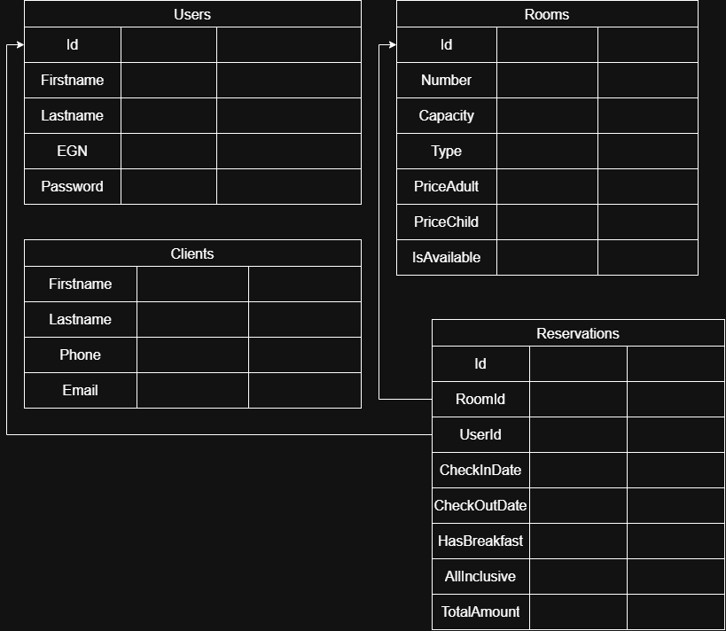

# 🏨 Hotel Reservations Manager (Система за управление на хотелски резервации)

Система за управление на хотелски резервации, разработена като част от учебен проект. Приложението позволява автоматизация на процесите по регистрация на клиенти, управление на стаи и обработка на резервации.

---

## 🛠️ Използвани технологии
* **Език за програмиране:** C#
* **Платформа / Framework:** .NET
* **База данни:** MS SQL Server
* **ORM:** Entity Framework
* **Инструмент за диаграми:** draw.io

---

## 📂 Структура на проекта
* `01-анализ/` — Изисквания и аналитични документи.
* `04-дизайн/diagrams/` — UML и архитектурни диаграми на системата:
* `er-diagrama.drawio.png` — База данни (ER диаграма)
* `component-diagram.png` — Архитектурни слоеве (UI, BLL, DAL, Database)
* `class-diagram.png` — Основни класове и свойства

---

## ✨ Основни функционалности
* 👤 **Потребители:** Регистрация, вход и управление на достъпа на служители.
* 👥 **Клиенти:** Добавяне и редактиране на данни за гостите на хотела.
* 🛏️ **Стаи:** Категоризация на стаи, капацитет и определяне на цени.
* 📅 **Резервации:** Създаване, редактиране и следене на престоя на клиентите.

---

## 📐 Архитектура и диаграми

### 1. ER Диаграма (База данни)

### 2. Компонентна диаграма (Component Diagram)

### 3. Класна диаграма (Class Diagram)

